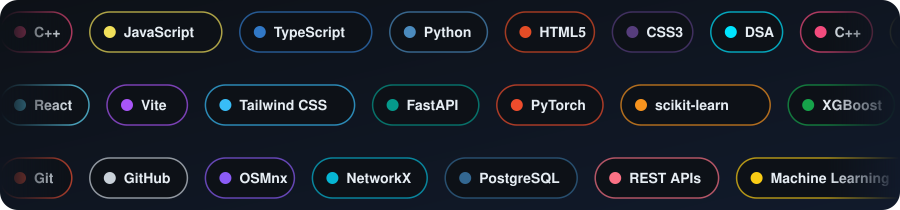
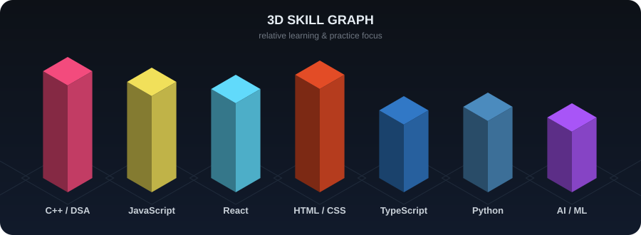
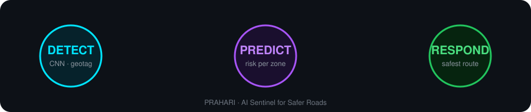
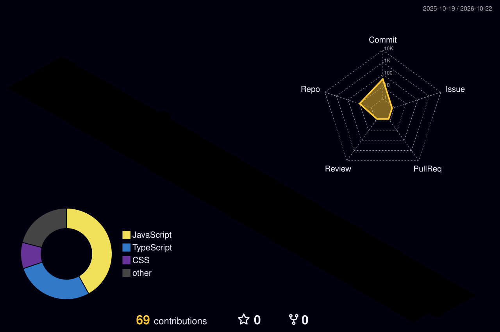

<!-- ═══════════════ HEADER ═══════════════ -->
<div align="center">


<a href="https://github.com/praveen-codes36">
  
</a>

<br/>


</div>

> **I am not trying to look successful.**
>
> **I am trying to become someone worth remembering.**

---

## 01. THE BEGINNING

Every developer has a first line of code.

Every builder has a first idea.

Every person who creates something meaningful starts at a point where nobody knows their name.

**This is mine.**

I am **Praveen Kumar**, a B.Tech student learning, building, failing, improving, and moving forward.

I don't have all the answers. I don't know everything. But I have something more important:

```
CURIOSITY
    ↓
COURAGE
    ↓
CONSISTENCY
    ↓
CREATION
    ↓
IMPACT
```

My biggest build so far is **PRAHARI AI**, a team project for **Smart India Hackathon 2026** (Transportation & Logistics) from **MNNIT Allahabad**, with **117+ commits** behind it.

---

## 02. 🧰 TECH STACK

<div align="center">
  
</div>

<div align="center">

| 🧠 THINK | 💻 BUILD | 🤖 EXPLORE | 🚀 CREATE |
|:--:|:--:|:--:|:--:|
| **Data Structures & Algorithms** | **C++ · JavaScript · HTML · CSS · React** | **Artificial Intelligence** | **Projects with real purpose** |

</div>

### 📊 3D Skill Graph

<div align="center">
  
</div>

---

## 03. 🚀 FEATURED PROJECT: PRAHARI AI

> **AI Sentinel for Safer Roads** · Smart India Hackathon 2026 · Team *COMMAND + WIN*

India has some of the highest road-accident fatalities in the world, and ambulances are routed by *distance*, not *safety*. Road defects (potholes, broken streetlights, drainage) and accident risk are treated as separate problems. **PRAHARI connects them.**

<div align="center">
  
</div>

| Stage | What it does | Tech |
|:--|:--|:--|
| 🔍 **Detect** | Citizens photograph a defect; a CNN classifies it (pothole / streetlight / garbage / drainage) and geotags it | PyTorch / TensorFlow, transfer learning |
| 📈 **Predict** | Scores accident risk per zone using history, weather, traffic and live defect density | scikit-learn, XGBoost |
| 🚑 **Respond** | Finds the fastest **and safest** ambulance path, not just the shortest | NetworkX, OSMnx, Dijkstra / A\* |

**Architecture:** React + Vite + Tailwind v4 + Leaflet dashboard → FastAPI backend → separate `ml-model` and `routing-engine` modules, with PostgreSQL/PostGIS for geo data.

[](https://github.com/praveen-codes36/prahari-ai)


---

## 04. PROJECTS ARE MY EXPERIMENTS

I don't see repositories as folders containing code. I see them as snapshots of my journey.

```
an idea I believed in
        +
problems I didn't understand
        +
bugs I couldn't solve
        +
things I had to learn
        =
someone I wasn't before
```

| Project | What it is | Stack |
|:--|:--|:--|
| 🛡️ **[PRAHARI AI](https://github.com/praveen-codes36/prahari-ai)** | AI for safer roads: defect detection, risk prediction, safest ambulance routing | React · TS · FastAPI · ML |
| 🔐 **[Trustify](https://github.com/praveen-codes36/Trustify)** | Uses AI to cut through online noise and show what information you can trust, *clearly, transparently and responsibly* | HTML · CSS · JS |
| 🔑 **[Password Generator](https://github.com/praveen-codes36/Password_generator_react)** | Password generator built to master React state and hooks | React · Vite |
| ⚛️ **[react_pro](https://github.com/praveen-codes36/react_pro)** | React practice and experiments | React |
| 🌐 **[sigma-web-dev-course](https://github.com/praveen-codes36/sigma-web-dev-course)** | Web-dev course work, fundamentals to projects | HTML · CSS · JS |
| 🧪 **[learn-git](https://github.com/praveen-codes36/learn-git)** | Where I practised version control | Git |

> Sometimes the best projects don't start with *"What can I build?"*
> They start with **"What problem deserves to be solved?"**

---

## 05. 🧊 3D CONTRIBUTION GRAPH

<div align="center">
  
</div>

## 06. 🐍 CONTRIBUTION SNAKE

<div align="center">
  <picture>
    <source media="(prefers-color-scheme: dark)" srcset="https://raw.githubusercontent.com/praveen-codes36/praveen-codes36/output/github-snake-dark.svg"/>
    
  </picture>
</div>

<div align="center">


</div>

---

## 07. THE PERSON BEHIND THE CODE

```cpp
class Praveen {

private:
    bool afraid = true;
    bool experienced = false;

public:

    string currentStage = "Learning";

    void future() {

        while (!experienced) {

            learn();
            build();
            fail();
            learnAgain();

        }

    }

};
```

The code above is incomplete. **So am I.** And that is the point.

---

## 08. THE JOURNEY

```
THE JOURNEY

┌──────────────────────────────┐
│        SOMEONE STARTED       │
│              ↓               │
│       THEY KNEW NOTHING      │
│              ↓               │
│         THEY LEARNED         │
│              ↓               │
│          THEY FAILED         │
│              ↓               │
│          THEY BUILT          │
│              ↓               │
│       THEY FAILED AGAIN      │
│              ↓               │
│       THEY DIDN'T STOP       │
│              ↓               │
│         THEY BECAME          │
└──────────────────────────────┘
```

> **I don't want to stay where I started.**

---

## 09. MATRIBHUMI 🇮🇳

# मातृभूमि

### A word that reminds me where I come from.

For me, **MATRIBHUMI** is not just a project name. It represents a question:

> **What if technology was built with responsibility?**

What if young developers didn't only build for marks, portfolios, or jobs?

```
Someone has a problem.

Someone needs a solution.

And maybe...

we can build it.
```

India has millions of problems. But it also has millions of young minds. And somewhere between those two things exists an opportunity to create something extraordinary.

**BUILD FOR PEOPLE. BUILD WITH PURPOSE. BUILD FOR THE FUTURE.** 🇮🇳

---

## 10. MY RULES

```
01  Learn without pretending to know.
02  Build without waiting for perfection.
03  Ask questions without being ashamed.
04  Fail without losing direction.
05  Help people whenever possible.
06  Stay curious.
07  Keep going.
```

## 11. CURRENTLY

```
┌─────────────────────────────────────────────┐
│   STATUS                                    │
│   🟢 LEARNING                               │
│                                             │
│   CURRENTLY EXPLORING                       │
│   ├── Data Structures & Algorithms          │
│   ├── Web Development                       │
│   ├── React                                 │
│   ├── Artificial Intelligence               │
│   └── Shipping PRAHARI AI (SIH 2026)        │
│                                             │
│   CURRENT OBJECTIVE                         │
│   └── Become better than yesterday.         │
└─────────────────────────────────────────────┘
```

---

## 12. FOR THE PERSON WHO FOUND THIS PROFILE

Maybe you are already a great developer. Maybe you are a student like me. Maybe you are someone who is afraid to start. If that is you, remember this:

```
Nobody begins as an expert.

Nobody writes perfect code on day one.

Nobody builds something great
without first building something small.

The first project may be ugly.
The first code may be bad.
The first attempt may fail.

START ANYWAY.
```

> **That was the moment everything started.**

## 13. THE PROMISE

I cannot promise that every project here will succeed. I cannot promise that this journey will be easy. But I can promise myself this:

# I WILL KEEP LEARNING.
# I WILL KEEP BUILDING.
# I WILL KEEP IMPROVING.
# I WILL NOT STOP BECAUSE THE BEGINNING IS SMALL.

## 14. ONE DAY...

Maybe years from now, someone will visit this profile. They will see hundreds of projects, things that don't exist today, a completely different person. But I hope one thing remains here:

```
Before everything...

there was nothing impressive.

There was only a student.

A computer.

A dream.

And the decision

to begin.
```

---

<div align="center">

### 🤝 Let's Connect

[](https://github.com/praveen-codes36)
<!-- [](YOUR_LINKEDIN_URL) -->
<!-- [](mailto:YOUR_EMAIL) -->

# THIS IS NOT MY SUCCESS STORY.
# THIS IS THE FIRST PAGE OF IT.

### — Praveen Kumar

`while (alive) { learn(); build(); improve(); }`


</div>
